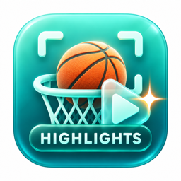
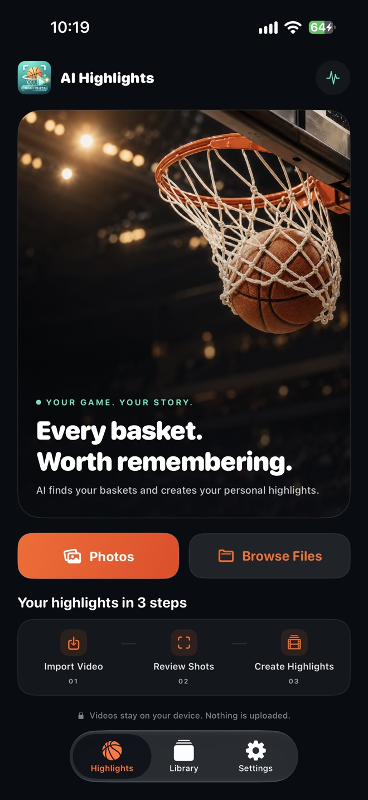
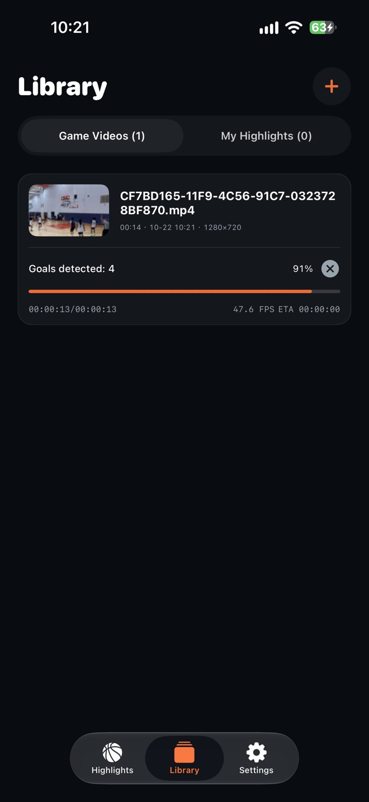
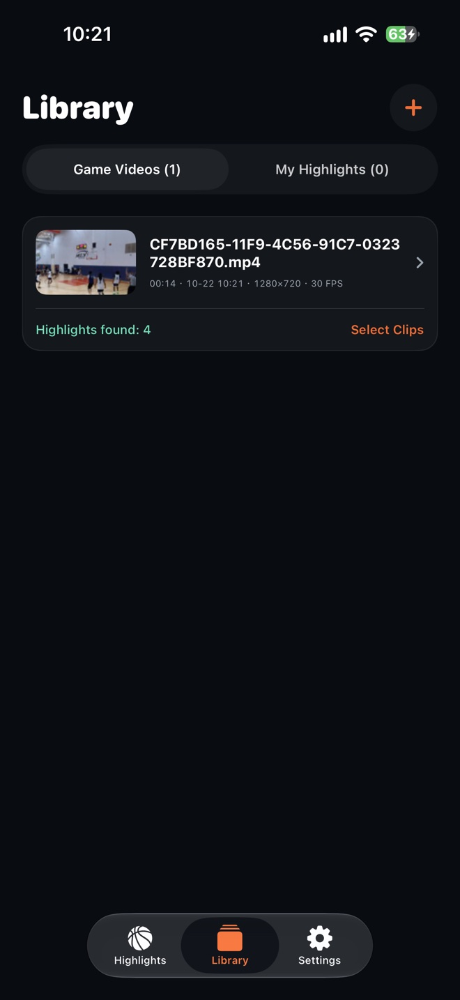
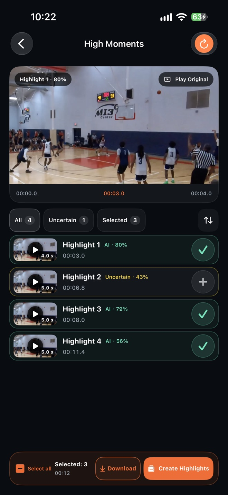
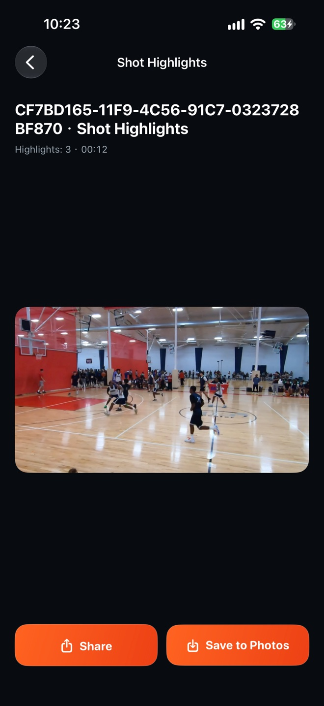
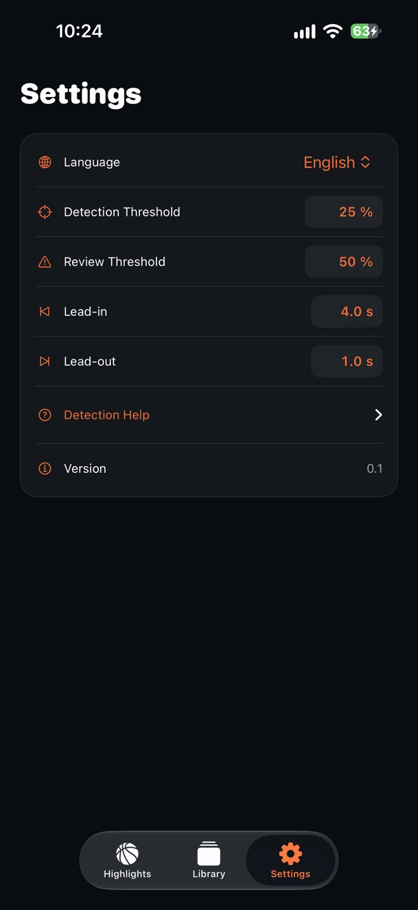

<div align="center">
  
</div>
<h3 align="center"><b>AI Highlights</b></h3>
<p align="center">
  <a href="./README_zh.md"></a>
</p>
**TL;DR:** AI Highlights is a native iOS app derived from [OpenHoopVision](https://github.com/feifeifei85/OpenHoopVision): it finds potential made-basket moments on-device, lets users review them, and exports selected clips as MP4.

## Screenshots

<table>
  <tr>
    <td align="center" width="16.66%"><a href="assets/home.jpg"></a><br><sub>Import</sub></td>
    <td align="center" width="16.66%"><a href="assets/analysis-progress.jpg"></a><br><sub>Analysis</sub></td>
    <td align="center" width="16.66%"><a href="assets/analysis-complete.jpg"></a><br><sub>Results</sub></td>
    <td align="center" width="16.66%"><a href="assets/review.jpg"></a><br><sub>Review</sub></td>
    <td align="center" width="16.66%"><a href="assets/exported-highlight.jpg"></a><br><sub>Export</sub></td>
    <td align="center" width="16.66%"><a href="assets/settings.jpg"></a><br><sub>Settings</sub></td>
  </tr>
</table>

## What it does

- **On-device scoring candidates:** use the bundled Core ML model to flag potential made baskets with confidence scores for review.
- **Adjustable, human-reviewed results:** tune detection and review thresholds, inspect uncertain candidates, and add or remove moments manually.
- **Flexible highlight creation:** adjust clip lead-in and lead-out, merge overlapping selections in source-video order, retain available source audio, and export an MP4.

## AI model and performance

The YOLO26n basketball detector was trained under the [OpenHoopVision](https://github.com/feifeifei85/OpenHoopVision) project using Ultralytics' official implementation and is included as an INT8 Core ML model with a 1280 × 736 input. The iOS inference implementation was developed with reference to the [Ultralytics YOLO iOS app](https://github.com/ultralytics/yolo-ios-app). Foreground analysis enables `.all`, letting Core ML choose from the CPU, GPU, and Neural Engine; GPU-only execution is not forced. Background inference is CPU-only.

Analysis scans the full video in order, sampling at up to 30 FPS, so longer videos take longer. Background analysis is subject to iOS scheduling. In one sample on iPhone 16 Pro Max, the app reported 47.6 processed frames per second; this is not a standardized benchmark.

## Scope and limitations

- Detection may be less reliable with poor camera angles, low-quality video, occlusion, or distant views.
- The app suggests shot candidates for review; it does not identify players or provide scorekeeping or full-game statistics.
- The app source and converted model are included; training data/configuration, the original checkpoint, and export script are not.

## Privacy and data

Analysis and highlight generation run on-device. AI Highlights does not upload videos to its own service or use analytics. Videos and project data in app storage may be included in iOS backups. Photos or Files may use the network to retrieve videos stored in iCloud or other cloud locations.

## Requirements and build

- iOS 17 or later
- Xcode with iOS platform support

Open `AI Highlights.xcodeproj` and select the `AI Highlights` scheme. To build without signing from the project directory:

```sh
xcodebuild -project "AI Highlights.xcodeproj" -scheme "AI Highlights" \
  -configuration Debug -destination 'generic/platform=iOS' \
  CODE_SIGNING_ALLOWED=NO build
```

## License

AI Highlights is an open-source personal project for learning and experimentation. The complete project, including the app source and bundled YOLO26n model, is licensed under AGPL-3.0 (see [LICENSE](LICENSE)). Ultralytics requires an Enterprise License for proprietary or commercial deployment; see its [license terms](https://www.ultralytics.com/license).
